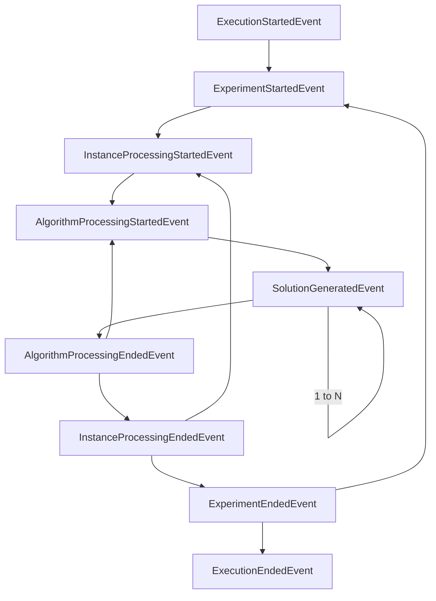

# Event system

## What

Events are actions or occurrences in any part of the application that may or may not be handled by listeners. Events are queued by Mork and dispatched from a single event dispatcher thread when certain actions happen (an instance is loaded, a solution is generated, an experiment ends, etc.). Framework event payloads are immutable Java records that implement the empty `MorkEvent` marker interface.

## Why

Events allow users to easily extend the framework functionality without directly modifying it. Any application component can listen to events and react to them, even triggering events in response.
Although not being able to immediately execute a method when something happens may appear a disadvantage, the dispatcher keeps user listener code outside the solver's critical path while preserving a simple interface.

## Event guarantees

- Event payloads are immutable.
- Events cannot be canceled or deleted once accepted.
- All Mork events are assigned an increasing event ID during dispatch and are dispatched in queue order, even when the execution order itself is not deterministic, such as when using a concurrent executor.
- An exception from one Mork backend listener does not prevent the remaining Mork listeners from receiving the same event.

The event queue accepts up to 100,000 events. Publication is non-blocking and fails fast if that capacity is exhausted.

## Graceful draining

At shutdown, Mork rejects new events from external threads and drains every event that it already accepted. Events published recursively by a listener on the dispatcher thread are still accepted and processed. Draining has no timeout: it completes only when the queue, including recursively generated events, is completed. The Spring context is closed only after `ExecutionEndedEvent` has been published and the event publisher has finished draining.

## Event lifecycle

The diagram describes processing and export scopes. In parallel execution, multiple instance and algorithm scopes may overlap. `WorkUnitStartedEvent` and `SolutionGeneratedEvent` describe actual repetition activity; solutions are published as soon as computation completes, independently of deterministic export order.



## Event types list

At different times during the experimentation, different events are triggered. The most relevant are: 

| Event name                        | Explanation                                                                           |
|-----------------------------------|---------------------------------------------------------------------------------------|
| `ExecutionStartedEvent`           | Fired once when solver is ready to start generating solutions                         |
| `ExperimentStartedEvent`          | Fired when starting each experiment                                                   |
| `InstanceProcessingStartedEvent`  | An instance has been loaded and is going to be solved by different algorithms         |
| `AlgorithmProcessingStartedEvent` | A pair (instance, algorithm) is scheduled for execution                               |
| `WorkUnitStartedEvent`            | A measured repetition starts: result UUID, ordinal and reproducible seed              |
| `SolutionGeneratedEvent`          | A solution has been generated for the tuple (Instance, AlgorithmConfig, Iteration)    |
| `AlgorithmProcessingEndedEvent`   | A pair (instance, algorithm) has finished executing                                   |
| `InstanceProcessingEndedEvent`    | An instance has been solved with all algorithm configurations and is no longer needed |
| `ExperimentEndedEvent`            | Experiment finalized, if there are no more experiments queued end                     |
| `ExecutionEndedEvent`             | Terminal outcome: SUCCEEDED, COMPLETED_WITH_ERRORS, FAILED or CANCELLED               |

## Implementing an event listener

### Backend

Implement `MorkEventListener`. Implementations are discovered automatically by Mork if they follow the template structure. If they are not discovered automatically, you can add the `@Component` or another Spring stereotype. Mork will invoke each listener directly on its dispatcher thread. Use pattern matching to select the event types the listener consumes. As an example, this is how the Telegram integration works:

```java

public class TelegramEventListener implements MorkEventListener {

    private final TelegramService telegramService;

    public TelegramEventListener(TelegramService telegramService) {
        this.telegramService = telegramService;
    }

    @Override
    public void onEvent(MorkEvent event) {
        switch (event) {
            case ExperimentEndedEvent experimentEndedEvent -> notifyExperimentEnd(experimentEndedEvent);
            case ErrorEvent errorEvent -> notifyError(errorEvent);
            case ExecutionEndedEvent ignored -> telegramService.stop();
            default -> {
                // Ignore event types we are not interested in
            }
        }
    }

}
```

Every listener receives the `MorkEvent` marker type and decides which payload types it consumes. An exception from one listener is logged and does not prevent the remaining listeners or later events from being dispatched. Listener classes may request `MorkEventPublisher` via the constructor and publish their own events, but be careful of infinite recursion.

### Frontend

The template frontend first reads `/api/monitor/status`. Standard execution mode opens the snapshot dashboard
described below; coordinator IRACE/autoconfig mode opens the [tuning glass panel](irace.md#monitoring-a-tuning-run),
and follower mode shows a worker notice. Instance utilities show a separate utility notice. Mode detection works without the autoconfig module.

Standard results, issues and progress come from `/api/experiments` snapshots. The STOMP stream at `/topic/events` provides refresh notifications. On first connection the client subscribes before reading `/lastevent` and establishes the notification baseline from its head. Live messages are buffered/deduplicated by `(eventLogId,eventId)` and delivered contiguously. Gaps and reconnect catch-up use history batches of at most 1,000. REST polling remains active when WebSocket delivery is unavailable.

Transport metadata remains in `EventEnvelope`; payload objects are never modified. Ping and custom event types advance event accounting safely. 

The backend records actual starts and completions before ordered export handling. Successful and failed results count as completed repetitions; cancelled work does not. Failed/missing/non-finite scores do not enter statistics or best calculations. The first ordered status objective is selected by default; switching changes raw scores, references, best-across-repetitions, distributions, runtime plots and best-result selection using `MINIMIZE`/`MAXIMIZE`.

All instances are server-paginated. The browser caches at most ten visited details and refreshes chart data at most every two seconds, with immediate selection/reconnect/final updates. Large charts are labelled sampled; statistics and result exports remain exact. See [normal experiment monitoring](normal-experiment-monitoring.md) for APIs, counter semantics and solution-view retention.

From `template/frontend`, run `npm start` for development, `npm run typecheck`, `npm test`, or `npm run build`. Release builds use `npm run build:static` and commit the generated `template/src/main/resources/static` files so generated projects require no Node.js installation.

Problem-specific visualization uses the optional backend `SolutionViewProvider` and frontend `SOLUTION_RENDERERS` registry. Renderers receive typed result metadata, selected objective and retained JSON view data; the default inspector remains useful without a custom renderer. See the frontend README for the extension contract.

## Using custom events

Triggering custom events is extremely easy, for example in custom algorithms such as genetic algorithms.

Define an immutable record that implements `MorkEvent`, fill it with data from any part of your code, and propagate it to the framework using `MorkEventPublisher`.

```java
public record PopulationUpdatedEvent(
        int generation,
        double bestScore
) implements MorkEvent {}

public class GeneticAlgorithm extends Algorithm<MySolution, MyInstance> {

    private final MorkEventPublisher eventPublisher;

    public GeneticAlgorithm(MorkEventPublisher eventPublisher) {
        this.eventPublisher = eventPublisher;
    }

    @Override
    public MySolution algorithm(MyInstance instance) {
        // [...]
        eventPublisher.publish(new PopulationUpdatedEvent(generation, bestScore));
        // [...]
    }
}
```

Records are the preferred event payload type because their components are final and their accessors are unambiguous. If a record component is a mutable collection, make a defensive copy in the compact constructor.

## Event API

`GET /lastevent` returns `{eventLogId,lastEventId}`; an empty log explicitly reports `lastEventId: -1`. `GET /events?eventLogId=<id>&from=<inclusive>&to=<exclusive>` returns `{eventLogId,lastEventId,from,to,events}`. Invalid ranges or ranges larger than 1,000 are HTTP 400; a different process identity is HTTP 409. Event ranges use an indexed lookup. A restarted backend has a different UUID even if its new head is numerically greater than the previous cursor.

WebSocket messages and REST history entries expose envelopes. Transport metadata exists only in the envelope: `eventLogId` identifies the process log, `eventId` is assigned during ordered dispatch, `timestamp` is the event acceptance time, and `workerName` is the producer thread name. Payload JSON contains only event-specific data and does not duplicate `type`, `timestamp`, or `workerName`:

```json
{
  "eventLogId": "0a169cd8-9417-4d86-a5f7-cc718603bfe0",
  "eventId": 42,
  "type": "SolutionGeneratedEvent",
  "timestamp": 1782912345678,
  "workerName": "worker-1",
  "payload": {
    "resultId": "d290f1ee-6c54-4b01-90e6-d701748f0851",
    "experimentName": "default",
    "instanceName": "instance-01",
    "algorithmName": "myAlgorithm"
  }
}
```

Use the payload when reacting to event-specific fields. A result ID is a `UUID` in the Java API and is serialized as a JSON string. Use `resultId` from `SolutionGeneratedEvent` with `ResultStore.findSolution(UUID)` when server-side code needs the full solution.
